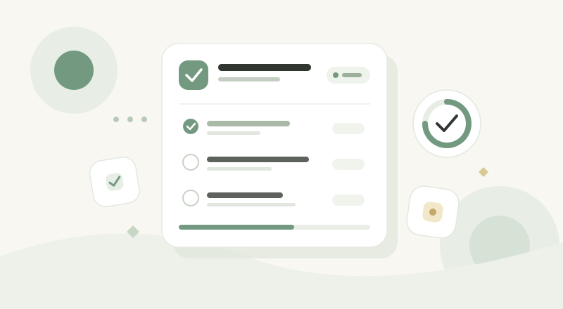

## 我想解决什么问题

现在每天背单词打卡，签到打卡……需要打卡的项目越来越多，该如何记住所有的打卡项目并且每天打卡

## 首版只做这些

- 记录打卡项目
- 完成每日打卡
- 暂时不做什么，避免项目越做越大。

## 一条完整的使用路径

用户打开页面 → 添加打卡项目 → 前端调用API → 后端保存打卡信息（名字，周末是否打卡，分类） → 页面添加一行打卡信息每天更新

## 技术与数据

- 前端：Next.js + React
- 后端：Node.js + TypeScript（为了尽可能简单，不使用后端框架）
- 数据库：PostgreSQL
- 核心数据：user表（id、用户名、密码）、task表（名字、所属用户、分类、周末是否打卡）

## 下一步与想问的问题

- [ ] 画出主要页面。
- [ ] 实现基本的 API。

我希望大家帮我看看：可行吗？
