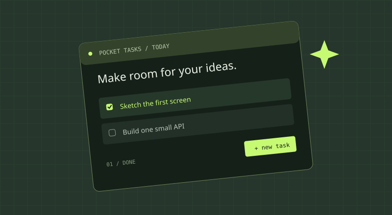

## 我想解决什么问题

脑中总会出现零散的想法，如何随时随地记录并方便查找呢？

## 首版只做这些

- 记录文字想法，且可添加标签
- 建立连接：选中两条或多条想法，点击连接，可输入关系关键字
- 暂时不做多人协作、复杂可视化，避免项目越做越大。

## 一条完整的使用路径

用户打开页面 → 在输入框写下想法A → 前端发送这条想法文字内容 → 后端验证输入、返回刚创建的想法，前端把它加入列表，用户新增一条想法B，给它打上标签。用户选中这两条想法，点击连接，输入关系关键字C，前端向 POST /api/connections 发送 from_id、to_id 和 relation。后端校验两条想法存在，把连接写入 SQLite，返回成功。刷新页面，前端通过 GET /api/ideas 取回所有想法，通过 GET /api/connections 取回所有连接，按标签和关系重新渲染。 → 用户在搜索框输入关系关键字C，前端请求 GET /api/connections，页面列出所有关系为C的想法连线。

## 技术与数据

- 前端：TypeScript。
- 后端：Node.js，框架待决定。
- 数据库：待决定。
- 核心数据：有哪些字段？

## 草图

下面是模板占位图，请替换成你的草图或删除。

## 下一步与想问的问题

- [ ] 确定首版范围。
- [ ] 画出主要页面。
- [ ] 跑通一个 API。

我希望大家帮我看看：此项目是否可行。
